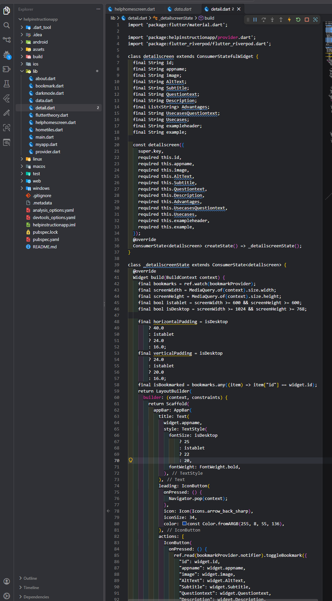

# App-Reponsive-
A fully responsive Flutter Weather App featuring a clean, user-friendly interface that adapts seamlessly to different screen sizes and devices.

## 📸 Screenshots

### Home Screen

## 🎥App-Reponsive- Demo

Watch my Weather App demonstration:

[▶️ Click Here to Watch Weather App Demo](https://drive.google.com/file/d/1uNU6w9FV7nxwI-T-CKgyUUvhN-d5pBcn/view?usp=sharing)

## 🚀 Getting Started

1. Clone this repository.
2. Run `flutter pub get`.
4. Run `flutter run`.

## 👨‍💻 Developer

Kunal Sirmour
